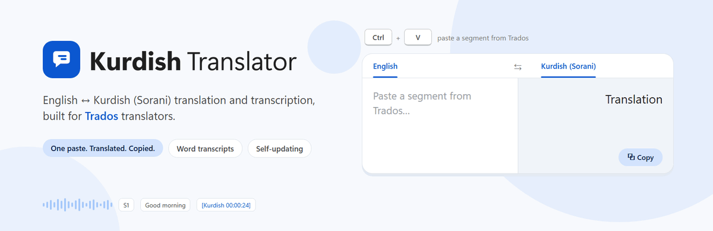
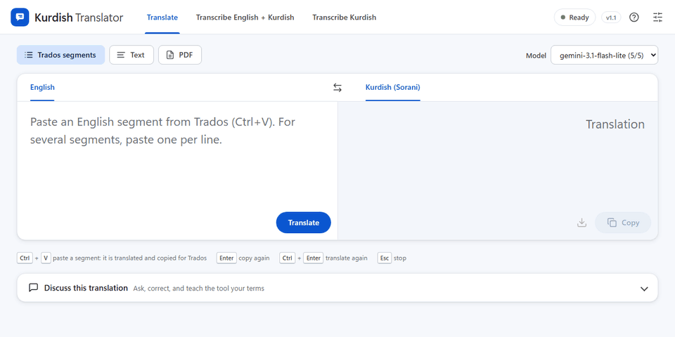
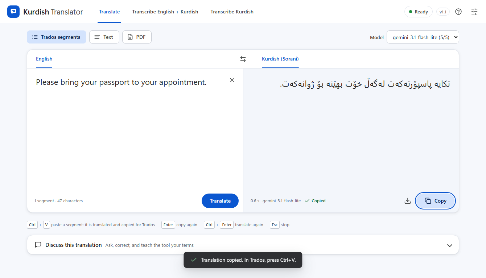
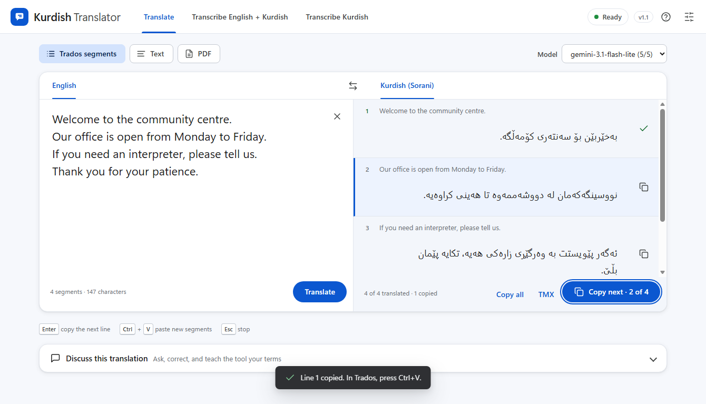
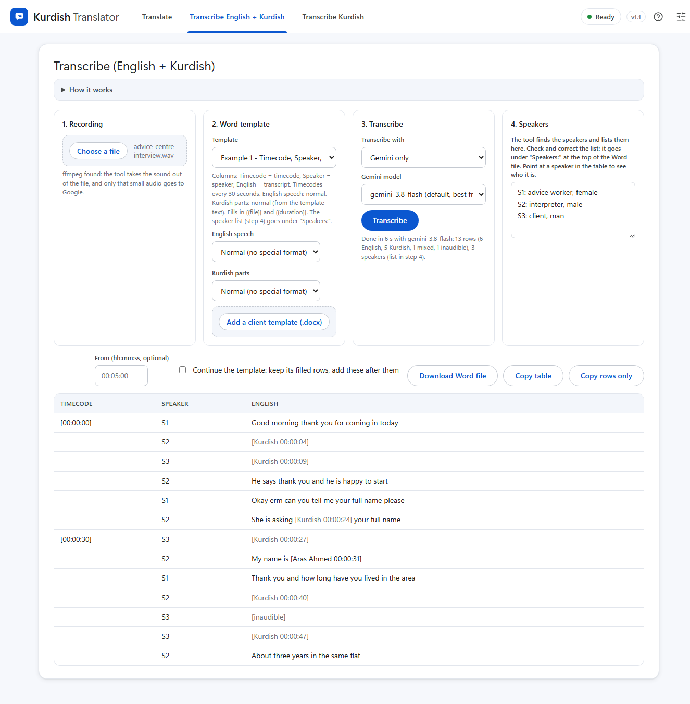
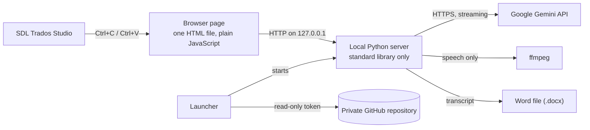

**English ↔ Kurdish (Sorani) translation and transcription for professional translators, built to work next to SDL Trados Studio.**

Copy a segment in Trados, press Ctrl+V in the tool, and the checked translation is already on the clipboard. Press Ctrl+V in Trados. That is the whole loop.

> **The source code is private.** This repository shows what the tool does and how it is built. All texts in the pictures are made-up samples. A live demo is available on request.

Current version: <!-- version -->1.1 (31 October 2026)<!-- /version --> · [Changelog](CHANGELOG.md)

## Why

Translators work segment by segment in Trados. With a normal AI chat or web translator, each segment needs several clicks, and the AI text often fails Trados QA checks: extra line breaks and spaces, quotation marks that the source does not have, Arabic-Indic digits, and missing direction marks around numbers in right-to-left text.

This tool makes the loop one paste in each direction, and it fixes these problems before the text gets to Trados.

## Features

### Translation for Trados

- **Paste anywhere.** One Ctrl+V on the page translates the segment and copies the translation to the clipboard. You do not click a box or a button.
- **Automatic direction.** The tool sees the script of the pasted text: English goes to Kurdish, Kurdish goes to English.
- **Never stuck on a busy model.** Each translation starts with the best-rated model. If Google is busy or slow, the next model takes over for that one segment, and the page says which model answered.
- **Many segments at once.** One numbered row for each segment. The tool checks that no segment is lost or merged, and asks again for missing lines. Enter copies the next row for Trados.
- **Clean for Trados QA.** No stray line breaks, spaces or quotation marks. The final full stop matches the source.
- **Kurdish typography.** Western digits, left-to-right marks around dates, number ranges and phone numbers, and other fixes that models often miss. For Kurdish → English, British spelling.
- **TMX export.** Saves the segment pairs as a TMX file, to pre-translate whole documents from a Trados translation memory.
- **Text and PDF views** for letters, e-mails and scanned documents. You can edit a translation before you copy it.
- **Discuss and learn.** Discuss a translation with the model. Then the tool proposes glossary terms and house rules from the discussion, and you choose which to keep for future translations.

### Transcription

- **English recordings with Kurdish parts** become a transcript table in the client's own Word template: timecodes, speakers and the template's formatting.
- **Google Gemini models, under UK data terms.** In the UK, Google's Gemini API terms for paid services apply to all use: Google does not use the audio or the transcript to improve its products, and it keeps requests only for a limited time, to detect abuse. The tool deletes each upload right after the transcription.- **The model finds the speakers itself** and describes them (for example "S2: interpreter, male"). Rows where the speaker is not certain are marked for review.
- **Kurdish parts get time-stamped markers**, so the translator can find each place in the audio and type the translation over the marker.
- **Long recordings and large videos.** ffmpeg extracts only the speech: a 1.2 GB video becomes about 5.5 MB of audio. Recordings longer than 25 minutes go to the model in parts, and the speaker list carries from part to part.
- **Continue a partly finished transcript** from a given time, in the translator's own document.
- **Kurdish-only recordings** become a plain-text transcript with the speakers marked.

### Set-up and updates for a small team

- **One-click setup** on a colleague's PC: a portable Python (checked with SHA-256), no admin rights, and a desktop shortcut.
- **Automatic updates** from a private GitHub repository with a read-only token. Before each update the tool makes a backup and, after it, a self-check. If the new version does not start, it goes back to the backup.
- **Personal files stay personal.** Each person keeps their own API key, glossary additions and client templates. Updates never change them.

### Privacy and reliability

- The server listens on 127.0.0.1 only and refuses requests from other websites.
- The tool saves no texts. Texts and recordings go only from the PC to the Google Gemini API, under Google's UK data terms (not used to improve Google's products).
- When a model is busy, the tool tries again or switches to the next model by itself. Messages about quotas, keys and the network are in plain words, with what to do next.

## Screenshots

**A Trados segment**: pasted with Ctrl+V, translated, and already copied.

**Several segments**: one row for each segment, and "Copy next" for Trados.

**Kurdish → English**: the tool detects the language of the paste.

**Transcription**: speakers found by the model, Kurdish parts marked with their time, ready for the Word template.

## How it is built

| Part | Technology |
| --- | --- |
| Server | Python 3, standard library only: no packages to install |
| Page | One HTML file with plain JavaScript and CSS, a clean Material-style design, right-to-left layout for Kurdish |
| AI | Google Gemini API with streamed answers, and a switch to the next model when one is busy |
| Audio and video | ffmpeg |
| Word files | Made directly from the client's .docx template (Office Open XML) |
| Setup and updates | PowerShell and Python, GitHub API |
| Tests | About 300 automated checks in Python and Node.js, with a fake Gemini API, run before each release |

## About

Built by [RenwarKarim](https://github.com/RenwarKarim) for a translation team, with AI pair programming (Claude Code).

The code, the prompts and all client material are private. This page has no client data.
