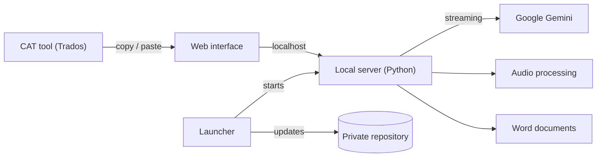

**A local desktop tool for English ↔ Kurdish (Sorani) translation and transcription with Google Gemini, built for a translation team that works in SDL Trados Studio.**

> The source code is private. This repository gives an overview of the tool. All texts in the pictures are made-up samples.

Current version: <!-- version -->1.1 (31 October 2026)<!-- /version -->

## Architecture

## Technical overview

- **Lightweight stack.** A local Python server with no third-party packages, and a single-page web interface with no framework or build step.
- **Real-time streaming.** Translations appear while the model writes them.
- **Resilient AI requests.** The preferred model is always tried first. When a model is busy or slow, the tool falls back to other models automatically.
- **Secure by design.** Everything runs on the user's own PC, and the server accepts requests only from its own page.
- **Clipboard-first workflow.** Built around copy and paste with a CAT tool: automatic language detection, right-to-left text support, and clean-up before the result is copied.
- **Batch processing.** Many segments in one request, with checks that every segment comes back.
- **Audio and video.** Speech extraction and support for long recordings.
- **Document output.** Word documents generated from templates.
- **Self-updating.** A one-click installer and automatic updates, with backup and rollback.
- **Tested.** An automated test suite with a simulated AI service runs before every release.

## Data

Text and audio go only from the PC to the Google Gemini API, under Google's UK data terms: Google does not use them to improve its products.

## Screenshots

 

## About

Built by [RenwarKarim](https://github.com/RenwarKarim) with AI pair programming (Claude Code). The code, the prompts and all client material are private.
